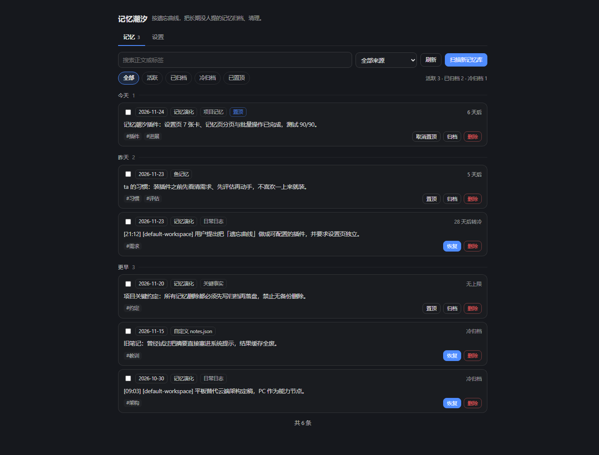
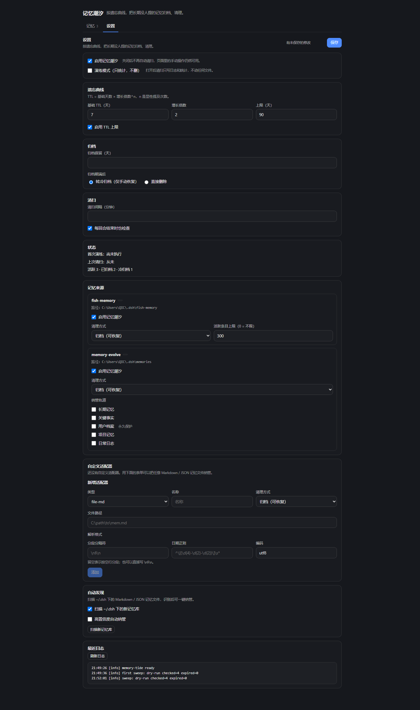

# dsh-memory-tide（记忆潮汐）

[](https://www.npmjs.com/package/dsh-memory-tide)
[](https://github.com/QIC-9821/dsh-memory-tide/actions)
[](https://github.com/QIC-9821/dsh-memory-tide/blob/main/LICENSE)
[](https://nodejs.org)

给 DSH 的记忆插件加一条**遗忘曲线**：长期没被提起的记忆会自动归档、转冷归档，或按你的选择直接删除。

**常驻 token 增量 = 0**：不注册工具、不向 systemPrompt 注入任何内容，只作为后台清扫器和设置页存在。

English: a forgetting-curve janitor for DSH memory plugins — per-entry TTL with spaced repetition, hot/cold archive, adapters for `dsh-fish-memory` and `dsh-memory-evolve`, generic Markdown/JSON adapters, and a memory board in Settings. Zero injected tokens.





## 为什么

记忆插件擅长「记」，不擅长「忘」：条目只增不减，库越来越大，检索越来越慢，真正有用的反而被埋掉。记忆潮汐补上后半段：

- 一条记忆从最后一次活跃开始算寿命。默认用**指数衰减**：强度按半衰期（默认 7 天）指数下降，掉到存活阈值（默认 0.1）才算忘。
- 你在对话里**明确提到**它 → 倒计时重置，且每多提一次，强度 ×倍数（默认 ×2，模拟间隔重复），于是下一次期限按 `log2(倍数)` 叠加。
- 想用简单算法就把模型切成**常数叠加**：`ttl = base × growth^touches`。
- 到期 → 进热归档（可恢复）；再放 30 天 → 转冷归档（只能手动恢复，永不自动删除）；也可以选直接删除。
- 上限可关：不设 90 天上限，就按曲线一直涨，等于「越重要活得越久」。

## 功能

- **遗忘曲线**：两种模型可选——指数衰减（默认，`强度 = 2^(-t/base)`，提及 ×growth，低于存活阈值才到期）与常数叠加（`ttl = base × growth^touches`）；半衰期/基础值、倍数、存活阈值、上限、是否设上限全部可改。
- **提到即续命**：字符 n-gram 匹配用户消息与记忆原文，命中才重置；保护词与置顶条目永不自动删。
- **两级归档**：热归档可恢复，冷归档只可手动恢复；归档保留天数可配，期满处理可选「转冷归档」或「直接删除」。
- **直接改别人的存储**：适配 `dsh-fish-memory`（JSON）与 `dsh-memory-evolve`（`MEMORY.md` 五轨），不需要对方配合。
- **通用适配器**：任意 Markdown / JSON 记忆文件都能按映射纳管（路径、分隔符、日期正则、列表路径都可配）。
- **自动发现**：扫 `~/.dsh` 下的疑似记忆库，识别格式、预览前 3 条，一键纳管（默认只提示，不自动接管）。
- **记忆面板**：设置 → 记忆潮汐，按时间从新到旧分组，搜索、筛选、单条/批量归档、删除、恢复、置顶。
- **重复记忆整合**：同一来源、同一文件、同一轨里的近似重复条目合成一条；可选「保留最新」或「按最新日期改写」——把旧记忆里的时间/数字换成新的，同时留下旧句的前置条件（例如「7 点有个计划」+「改到 10 点」→「10 点有个计划」）；正文末尾可保留最近 N 次合并的日期；纯本地计算，0 token。
- **可扩展**：其它插件可以调 `ctx.memoryTide.registerSource({ id, label, list, remove })` 把自己注册进来。
- **卸载即隐身**：记忆来源的目录/文件不存在时，设置页和来源下拉都不会再显示它；重装后刷新自动回来。

## 安装

```bash
dsh plugin --profile desktop add dsh-memory-tide
```

或从 GitHub 装：

```bash
dsh plugin --profile desktop add github:QIC-9821/dsh-memory-tide
```

装完确认 profile 的 `dsh.profile.bundles` 里有 `dsh-memory-tide`（CLI 通常会自动加；没加就手动补），刷新 Web GUI，然后打开 **设置 → 记忆潮汐**。

要求：DSH ≥ 0.2.3（在 0.2.3-alpha.2 上验证）、Node ≥ 22。宿主、Web 设置页与打包胶水都在这一个包里，不需要额外 SDK 依赖。

## 第一次使用

1. 打开 **设置 → 记忆潮汐**，先看「来源」：fish-memory 与 memory-evolve 会自动出现。
2. 开着**演练模式**跑一轮（或等第一次自动清扫）：只写报告，不动存储。
3. 确认计数与到期时间符合预期后关掉演练模式。**首次清扫无论设置如何都只演练**，第二次起才真删。
4. evolve 的「项目记忆 / 日常日志」两轨默认关闭（每回合都写、增长很快），需要再开，开了会显示红色警告。

## 设置项

| 设置 | 默认 | 说明 |
|---|---|---|
| 总开关 | 开 | 关掉后只保留板块浏览，不做任何自动清理 |
| 演练模式 | 关 | 打开后只写报告，不动存储 |
| 曲线模型 | 指数衰减 | 指数衰减（艾宾浩斯）或常数叠加；默认指数 |
| 基础期限 / 半衰期 | 7 天 | 指数模式是半衰期，常数模式是基础 TTL |
| 增长倍数 | 2.0 | 每被明确提到一次，强度 ×倍数（指数）或期限 ×倍数（常数）；1.0 = 只重置不加速 |
| 存活阈值 | 0.1 | 仅指数模式：强度掉到它以下才算到期；越小活得越久 |
| 上限开关 | 开 | 关掉 = 无上限，按倍数一直涨 |
| 上限期限 | 90 天 | 上限开关打开时生效 |
| 归档天数 | 30 天 | 归档后多久转冷归档（期满处理选「直接删除」则期满硬删） |
| 期满处理 | 转冷归档 | 冷归档不注入、不在默认视图，只能手动恢复，永不自动删除 |
| 清扫间隔 | 30 分钟 | 后台兜底间隔；每回合结束也会触发一次（有去抖） |
| fish 适配器 | 开 | 归档模式，最多 300 条活跃条目 |
| evolve 适配器 | 开 | memory/key 两轨开启；user 永久保护；project/daily 默认关 |
| 重复整合 | 关 | 开启后每次清扫先合并近似重复条目，再做到期清理 |
| 整合方式 | 保留最新 | 「按最新日期改写」会保留旧句前置条件、替换时间/数字 |
| 相似度阈值 | 0.7 | Dice 2-gram；越高越保守 |
| 保留日期数 | 3 | 合并后在正文末尾记下最近几次的日期；0 = 不写 |

## 它怎么动你的记忆

1. 每轮结束（或定时器到点）读一遍各来源，给新条目登记 `firstSeenAt`。
2. 算到期：`lastActive = max(创建/最后活跃/最后被提到)`，加 `ttl` 得 `expiresAt`。
3. 到期 → 从源文件删除，同时把原文写进 `~/.dsh/memory-tide/archive/hot/`。
4. 热归档超过归档天数 → 转 `archive/cold/`（或按设置直接删）。
5. 任何一步失败 → 停在那条，记日志，不影响其它条目。

## 重复记忆整合

同一个文件里常有「同一件事说了三遍」的条目（今天一句、前天一句、上周一句）。整合时按 `来源 + 文件 + 轨` 分组，用 Dice 2-gram 找近似簇，簇内保留最新的一条，其余删除，正文不另写新句子。

- **保留最新**：正文原样保留最新那条，只把旧条目的日期记进正文末尾。
- **按最新日期改写**：以最新条目为底稿，把旧条目里的时间/数字槽位替换成新的值，旧句独有的前置条件作为补充句留下。例：旧「7 点有一个计划要出门，记得带伞」+ 新「10 点有一个计划要出门」→「10 点有一个计划要出门，记得带伞」。
- **日期标记**：正文末尾追加 `〔合并日期：2026-11-26、2026-11-20、…〕`，保留条数可配（0 = 不写），同一条再合并时去重并只留最新 N 个。
- **先预览再动手**：设置页「预览整合」只扫描不改文件；确认后「立即整合」才写盘。写前有备份，被删的重复条不进归档。
- **0 token**：全部是本地字符串比较与替换，不调用模型。改写是启发式的，预览会给出结果，拿不准就切回「保留最新」。

## 安全与隐私

- **全部本地**，不联网、不上传任何记忆内容。
- 改第三方文件前先备份到 `~/.dsh/memory-tide/backup/<时间戳>/`；写入用临时文件 + rename。
- evolve 会拿它的 `.memory.lock`；fish 写前比对 mtime，检测到并发修改就跳过。
- 格式不认识、schema 不符、文件被手工改过（drift guard 失败）→ 跳过并记日志，绝不猜。
- 首次一律演练；置顶条目与保护词（默认 `勿删,待确认,勿动,不要归档,不要删除`）永不自动删除。
- 不碰 billion-context 的压缩块、不碰会话归档（readprune / archive-manager）、不改 DSH 本体、不自动改其它插件配置。

## 数据目录

```
~/.dsh/memory-tide/
├─ settings.json          设置
├─ state.json             每条记忆的计数、状态、到期时间（不存正文）
├─ archive/hot/           已归档，可恢复
├─ archive/cold/          冷归档，仅手动恢复
├─ backup/                每次改动前的备份
└─ logs/sweep.log         清扫日志
```

卸载：从 profile 移除 `dsh-memory-tide` 并删掉 `~/.dsh/memory-tide/` 即可；归档文件在删除前不会被自动清掉，想保留就先拷走。

## 接新的记忆库

- **不改代码**：设置页「自定义适配器」选 `file-md` 或 `file-json`，填路径、分隔符、日期正则、列表路径，添加即可。
- **自动发现**：点「扫描新记忆库」，识别后一键纳管，或加入忽略名单。
- **写插件**：宿主里注册 `ctx.memoryTide.registerSource({ id, label, list, remove })`，面板与清扫会自动带上你的来源。

## 开发

```bash
node --test test/*.test.mjs
```

105 个用例：曲线、匹配、清扫、四个适配器、自动发现、面板与路由。适配器测试全部在 `mkdtemp` 里造数据，不碰真实记忆。

实现细节见 [docs/DETAIL.md](docs/DETAIL.md)，字段契约见 [SPEC.md](SPEC.md)。

## License

[MIT](LICENSE)
